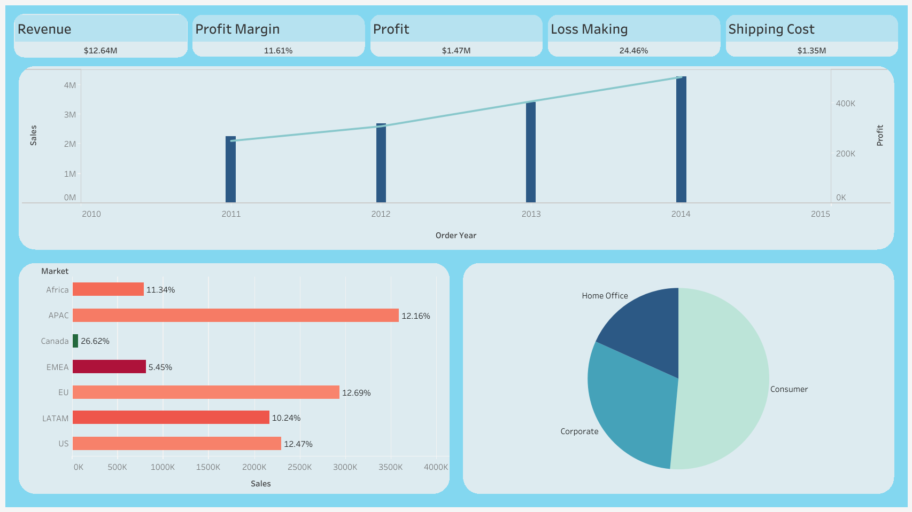

# Retail Performance Analytics & Discount Strategy Optimisation

## 📌 Project Overview
An end-to-end Python analysis of 51,290 retail transactions from the Global Superstore dataset,
covering 7 markets across 4 fiscal years (2011–2014). The project follows a professional analyst
workflow: raw data ingestion, data cleaning, feature engineering, and multi-dimensional analysis
culminating in a structured discount optimisation strategy with quantified business impact.

---

## 🎯 Business Questions Answered
- Which product categories and sub-categories are driving profit — and which are destroying it?
- What is the relationship between discount depth and profitability?
- Which markets are underperforming and why?
- How concentrated is profit across the product catalogue?
- Does higher shipping cost translate into better margins?
- What is the quantified impact of capping excessive discounts?

---

## 📊 Dashboard Preview


---

## 📊 Dataset
- **Source:** Global Superstore (public retail dataset)
- **Period:** 2011–2014 (4 fiscal years)
- **Markets:** 7 (APAC, EU, US, LATAM, EMEA, Africa, Canada)
- **Records:** 51,290 order lines across 3 product categories

---

## 🔑 Key Findings

| Metric | Value |
|--------|-------|
| **Total Sales** | $12.64M |
| **Overall Profit Margin** | 11.61% |
| **Loss-making Order Lines** | 24.5% |
| **Discount–Margin Correlation** | −0.847 |
| **Products driving 80% of profit** | 12.8% of catalogue |
| **Projected Profit Lift (scenario)** | +$414,820 (+28.3%) |
| **Projected Margin (post-optimisation)** | 14.89% |

- **Discounting is the primary margin killer** — discount rate correlates with profit margin at
  −0.847 (Pearson), the strongest signal in the dataset. Orders with >30% discount average deeply negative profit margins.
- **Furniture Tables** is the most destructive sub-category — running at −8.5% margin across
  861 orders with an average discount of 29.1%.
- **EMEA** has a systemic margin problem at 5.4% — less than half the APAC benchmark of 12.2% —
  suggesting a structural pricing or cost issue, not a product mix problem.
- **Profit is heavily concentrated** — only 12.8% of products drive 80% of total profit, weaker
  than the classic 80/20 rule, indicating significant tail drag from unprofitable SKUs.
- **Expedited shipping does not pay for itself** — First Class shipping costs 2× more as a share
  of sales versus Standard Class (16.8% vs 8.1%), yet margin is nearly identical (11.4–11.8%).
- **Revenue grew at ~25% CAGR** from 2011–2014, but profit margin stayed flat at ~11%,
  confirming that cost leakage is scaling with the business.

---

## ⚙️ Data Challenges Solved
- Raw dates in DD-MM-YYYY format — parsed correctly using `dayfirst=True` in pandas
- Numeric columns stored as strings — coerced using `pd.to_numeric(errors='coerce')`
- Postal Code missing for 80.5% of records — identified as expected for a global dataset, excluded from analysis
- Shipping cost not in standard numeric columns — added to coercion pipeline explicitly
- Scenario model validated to avoid double-counting: conservative fixed-volume approach used

---

## 💼 Business Impact
- Identifies which sub-categories and markets should be prioritised or deprioritised
- Quantifies the exact profit destruction caused by excessive discounting
- Provides a conservative, actionable discount cap scenario with a $414K projected uplift
- Pinpoints the 10 SKUs collectively destroying $44K in annual profit
- Demonstrates how flat margins despite revenue growth signals a cost structure problem

---

## 🛠️ Tech Stack
- **Language:** Python 3
- **Libraries:** pandas, numpy, matplotlib, seaborn, plotly
- **Visualisation (static):** Matplotlib, Seaborn
- **Visualisation (interactive):** Plotly
- **Dashboard:** Tableau Public
- **Environment:** Jupyter Notebook

---

## ▶️ How to Run

### 1. Clone the repository
```bash
git clone https://github.com/brian-t-mathew/retail-performance-analytics.git
cd retail-performance-analytics
```

### 2. Install dependencies
```bash
pip install pandas numpy matplotlib seaborn plotly jupyter
```

### 3. Set up data files
Place both CSV files in a `data/` folder
